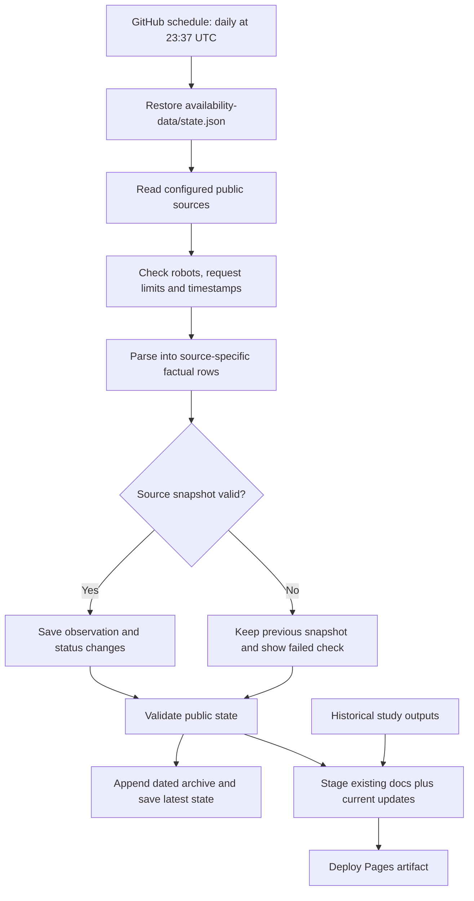

# Automated availability updates

## Decision

Use GitHub Actions for collection and validation, and keep GitHub Pages for hosting.
The existing Python parsers run on a standard Linux runner. Cloudflare would add another
runtime and storage system without solving a current need. No AI model or paid search API
is called by the scheduled workflow.

Standard GitHub-hosted runners are free for public repositories; artifacts and caches have
separate allowances. Keep the Pages artifact for one day, do not upload downloads, and do
not use larger runners. This is a low-cost design, not a promise that arbitrary GitHub
storage usage is free. [GitHub Actions billing](https://docs.github.com/en/billing/concepts/product-billing/github-actions).

## What this release does

- Collects the NBA's daily 5 PM Eastern report PDF, with a 30-minute publication allowance.
- Checks every men's conference page exposed by the existing SCACCHoops directory.
- Uses the same PDF layout for WNBA reports with a separate team dictionary. Collection
  runs in the configured May–October window; review that window and the dictionary each season.
- Carries a visible, disabled NCAA women's source until its provider's access policy and
  feed can be validated. It does not imply that women's basketball has no injuries.
- Saves factual observations and status changes, and publishes a Current availability view.
- Leaves historical risk scores, career results, news diagnoses and research denominators
  unchanged. Women's observations do not use the men's trained model.

This release does **not** automatically read news articles, infer a diagnosis or mechanism,
run the historical models again, backfill missed snapshots, or claim comprehensive NCAA
coverage. Those are separate extensions below, not hidden work on every refresh.

## Architecture



The source code stays on `main`. `availability-data` is a separate branch containing
`state.json` and `archive/YYYY/MM/<timestamp>-<hash>.json`; it does not contain source code,
PDFs, article text or credentials. The job does not make automatic commits to `main`.
Every collection adds an immutable factual snapshot to the archive. An identical retry is
idempotent; a correction creates a different file, never replacing the original observation.
The archive has no automatic expiry. The working JSON keeps the latest source snapshots
and 90 days of changes for fast display. Expiring that working list does not remove archived
observations. This is a history of source observations, not a complete injury registry or
a replacement for private raw-source evidence. Monitor archive size as coverage expands.

`data/updates/raw/` is an ignored local download cache, addressed by SHA-256. On GitHub's
ephemeral runner it disappears after the job. It is never placed in a cache artifact,
public data branch or Pages upload. The public snapshot holds its hash, factual fields,
source name, collection time and source report time when supplied.

Actions caches are only for Python packages. They are not the database. A missing data
branch is allowed only on first setup; an existing branch with missing/corrupt state stops
the run instead of silently discarding observations.
The first cloud collection seeds from the reviewed `docs/data/updates.json` snapshot and
archives that baseline before collecting anything new. A cloud-side source failure therefore
cannot discard the observations verified locally before launch.

## Collection and publication rules

- Schedule: `37 23 * * *`, once a day at 23:37 UTC: 6:37 PM Eastern standard time or
  7:37 PM Eastern daylight time. Both follow the 5 PM pro report's publication allowance.
  Manual runs and code pushes can also refresh the site. Freshness warnings use 36 hours
  to allow for daily scheduling and moderate delays.
- Source report time, first observed time, last successful collection and last attempted
  check are distinct. The source's own date controls dated-report freshness. SCACCHoops
  does not supply dates: a successful check cannot establish that a listing is recent.
- Normalize only availability, broad medical/nonmedical category, region and injury type.
  Do not publish the original reason or details text.
- A record key includes source, league, team, player name and game date where available.
  These are source identities, not resolved cross-league athlete IDs. No automatic joining
  to historical profiles, or merging namesakes across transfers, occurs in this release.
- Availability is not injury. Unspecified absences retain an unknown reason. Rest, illness,
  and nonmedical absences remain distinct from injury. A category is a text classification,
  not an independently verified medical diagnosis.
- First observed means first collected, not injury onset. Removal means absent from that
  report, not medically cleared, returned to play, or retired.
- Check robots for the configured reader and research agents. Reject unreadable policies,
  HTML masquerading as robots.txt, unapproved hosts, and redirects to unapproved hosts.
  Respect crawl delays and bounded retries. Do not rotate identities or bypass denials.
- A source's entire snapshot must validate before replacing its prior snapshot. A partial
  NCAA conference crawl cannot erase the conferences that failed. Large unexplained
  SCACCHoops listing drops are held for review. NBA unsubmitted reports are counted explicitly.
- Failed sources keep their original dates; other sources continue. A schema/state failure
  stops publication. A download failure produces a visible degraded-source warning, not
  an empty healthy roster. The page also calculates age in the visitor's browser so a
  stopped scheduler cannot leave an indefinitely fresh badge.
- Limit a run to 100 HTTP requests, 20 MB per response and a 20-minute job timeout. Source
  requests are sequential and spaced; no model training runs alongside collection.
- Scheduled work is serialized. Failed tests or staging errors prevent deployment. A
  deployment failure leaves the previously published site in place.

## Source checks, November 3, 2026

NBA: the existing documented PDF host permits the collector and the daily parser passed
a live test (44 listings). The separate index host returned 403 for this reader, so the
scheduled source uses the public daily PDF address, not the index. It is explicitly labeled
as a 5 PM snapshot rather than the latest intraday report. The source policy is recorded in
`config/update_sources.json` and checked again through robots on each run.

NCAA men: one full live pass checked 31 conference pages and returned 192 listings. These
are SCACCHoops observations, not a guarantee of national completeness. Empty pages must
explicitly say that there are no listings; a broken/changed page is an error.

WNBA: both a June 17, 2026 9:45 PM report (38 listings) and the 5 PM daily report
(26 listings) parsed with the separate team map. These were parser checks, not fresh
November data. The current collection calendar is paused. The restricted WNBA web index
is not fetched. [Official report page](https://www.wnba.com/wnba-injury-report).

NCAA women: the ACC provides women's availability reports through an embedded HD Intelligence
application. Its robots URL returned an HTML application shell in this check. Automated
collection is disabled until permitted access and its schema are verified. The SEC also
publishes a women's report page, but its robots policy restricts this research agent.
NCAA championship reports are tournament coverage, not a year-round all-school feed.
[ACC reporting policy](https://admin.theacc.com/sports/2025/8/28/availability-reporting.aspx),
[SEC women's reports](https://www.secsports.com/wbbreports),
[NCAA's 2026 tournament reporting program](https://www.ncaa.org/news/media-center-ncaa-releases-penalty-and-process-details-for-march-madness-player-availability-reports/).

## Run locally

Set `PYTHONPATH=src`, install `requirements.txt`, then:

```text
python -m unittest discover -s tests
python -m injury_risk updates --stage-site
```

Inspect `data/updates/site/dashboard.html#updates` through a local web server. State is in
`data/updates/state.json`; dated facts are in `data/updates/archive/`; the run summary is
`data/updates/site/update-summary.md`. On Actions, `--archive` points directly to the data
branch's archive directory. The Pages artifact contains the latest view, not the full archive.
The ordinary `site` build includes local observations when present and otherwise keeps
the published `docs/data/updates.json`. It does not fetch anything itself.

## Activate on GitHub

Done November 3–4, 2026: Pages deploys from Actions, `UPDATES_ENABLED` is `true`, and the first two cloud runs
were verified. Since then a push to `main` also collects and deploys. The steps are kept for setting it up again.
Repository instructions require the owner's request before committing or pushing.

1. Commit and push the reviewed code to `main` when authorized.
2. In Actions, manually run **Update availability and site** with `UPDATES_ENABLED` absent.
   This is a dry run: it collects and uploads a one-day preview artifact, but neither saves
   the data branch nor deploys the site. Check all source statuses and download the artifact.
3. In Settings → Pages, change the publishing source from the `docs` branch folder to
   **GitHub Actions**. This retains the same public site address.
4. Set the repository Actions variable `UPDATES_ENABLED` to `true`. Ensure the
   `github-pages` environment permits deployment from `main` and the token may write the
   separate `availability-data` branch. No personal access token is needed.
5. Run the workflow again. Check that `availability-data/state.json` was created, Pages
   deployed, and the public `#updates` page shows the same timestamps as the job summary.
6. Keep Actions failure notifications enabled in GitHub. Source-level degradation is in
   the job summary and dashboard; it does not send an email or create an issue automatically.

The `deploy` job only runs on `main` with the variable enabled. A manual run from another
branch can preview changes but cannot overwrite persistent state or publish the site.
Changing the variable back to `false` pauses automated collection and publication; the
existing site remains and its timestamps continue to age.

GitHub schedules are best-effort: they may be delayed or dropped, and scheduled workflows
in public repositories can be disabled after 60 days of repository inactivity. Check
workflow health during the planned monthly project review. A scheduled refresh is not an
exact-time alert service. [Schedule behavior](https://docs.github.com/en/actions/reference/workflows-and-actions/events-that-trigger-workflows#schedule),
[Pages deployment setup](https://docs.github.com/en/pages/getting-started-with-github-pages/using-custom-workflows-with-github-pages).

If a release breaks the presentation, redeploy a known good source revision with the
validated factual state. If a collector introduced bad data, restore a known good state
version on the data branch before rerunning. Never repair a rendered JSON by hand while
leaving its parser wrong.

## Next extensions

### Injury cases: a review checkpoint, not a seven-day lock

The daily feed currently stores availability observations. It does not yet resolve those
observations into medical injury episodes or conduct automated news research. When that
case layer is added, use the following policy:

- Link observations to a stable athlete and an injury episode only when the identity and
  episode match are supported. Multiple listings can describe one injury; the same player
  can also have separate injuries. Ambiguous joins go to review rather than being merged.
- Days 0–7: prioritize unresolved cases for daily checks. Record a diagnosis as confirmed
  only when a source supports it, never simply because seven days elapsed.
- After day 7: review a confirmed, stable diagnosis weekly and on any new report, operation,
  setback, conflicting diagnosis, or stated reevaluation date. Unresolved/conflicting cases
  stay in the higher-priority queue. These are collection defaults, not medical timelines.
- Keep availability current through the daily feed throughout the episode. A verified
  return ends routine case follow-up; disappearing from a report does not establish return.
- Update the same case's current summary when new evidence arrives, while appending a
  dated revision with source and observation time. Never erase its earlier versions.
- Archived cases remain correctable. A season-ending label is not evidence of recovery.

This avoids a permanent lock that would preserve an early, incomplete diagnosis. It also
avoids paying for daily news research on every old case. The implemented append-only
observation archive provides the foundation; the case identity and news-review layer is
still a separate extension.

#### Built so far: an NBA case builder in the daily job (November 2026)

`python -m injury_risk cases --archive <dir> [--fill]` (`src/injury_risk/cases.py`, tests in `tests/test_cases.py`).
The workflow runs it after collecting, with `--fill`, and commits `cases.json` beside `state.json` on the data branch.
It is not on the site, and a failure there leaves the availability update and the deploy untouched.

- Reads every NBA report in an archive. A report read twice counts once, from its first observation; a report
  republished under the same time with other rows replaces it from when it was observed.
- `--fill`: a game day of the season, up to 30 days back, with no archived report has its 5 PM report read from the
  league's site, with the daily job's reader and checks (`updates.fill_reports`), and archived as its own observation:
  the report's time and when it was actually read, marked as read later. The latest state and its change log are left
  alone. A day whose report can't be read is listed in `game_days_without_report`, never invented. The season's first
  two weeks, October 20 to November 2, were filled this way.
- Matches names to NBA player ids with `labels.match_players` (team, then season, then last name and initial, then a
  close spelling) against the season's box scores and inactive lists. Unmatched and uncertain matches go to a review list.
- Follows each player game by game with the historical rules (`labels.classify_absences`, `labels.find_onsets`). The
  case id is the player and the first game missed, so new game dates on later reports don't create new cases. A case
  ends with its run of injury absences, at a game played or missed for another reason (`ended_with`: a coach's decision,
  rest, a G League assignment); the return is the next game played, even after such a game.
- States: `listed` (open, on the team's latest report), `off_report` (open, gone from it without a game played, so not
  a return), `returned` and `ended` (the run ended with another kind of absence and no game played since). The team's
  latest report is the newest that covered one of its games: reports list the day's games and often the next day's, and
  a team that hadn't submitted yet isn't covered. A case under way at the player's first game, or before the first
  archived report, says so instead of guessing its start. Review: daily for 7 days, then weekly, while open.
- Listings to miss a game that has no box score yet wait as `upcoming` until the game is played.
- Season files come from the same sportsdataverse releases as the history (updated daily, about 300 KB in all).
  A December NBA Cup game whose teams aren't decided yet is left out of the schedule.

Check on history (`--replay SEASON`): the 5 PM reports of 2025-26 and 2024-25, saved in the daily job's normalized
format, reproduced 1,126 of 1,127 and 1,184 of 1,185 historical onsets with the same games missed and last game
missed, except where an injury ran into the next season. Every return the history records inside the season matches
(896 and 928); the history has no return when the next game was another kind of absence, and the cases find the later
one (230 and 176). One case each season differs by a game because of a blank reason ("-"): the daily data saves it as
unknown, which can join a run of absences, while the history keeps it as "other". The one 2024-25 onset not found had
its only injury listing in the next season.

Not yet: nothing is published; open cases need carrying into the next season at the rollover. Next: review a week by
hand, then publish and queue open cases for news research on the review schedule.

1. **College women's coverage:** resolve permitted access to conference feeds, add per-feed
   fixtures and exact athlete/game IDs, and show coverage by conference before expanding.
   Add other men's conferences through the same adapters rather than interpreting missing
   reports as available. Keep medical reasons unknown where conferences publish only status.
2. **News discovery:** use explicitly permitted official/team RSS or feeds, store candidate
   URLs privately, and resolve athlete identities against rosters. Park ambiguous names,
   conflicting diagnoses and stale articles. The current observation event log can seed
   that queue, but cannot confirm mechanisms or surgery. Publication still passes the
   existing evidence checks and audit rules. Do not run broad AI web research on every daily refresh.
3. **Monthly research release:** version the data cutoff, fetch only new/current-season
   games, and test identity joins and exposure completeness before rebuilding profiles,
   career follow-up and results. Preserve prior releases. Historical observations can be
   corrected by sources or improved parsers, so freeze published versions rather than assume
   history can never change. Full retraining is a deliberate release, not an ingestion side effect.
4. **Prospective risk scores:** persist a trained model plus feature schema, build leakage-safe
   pregame rows, and run calibration/drift checks before making live risk estimates. Keep
   the historic holdout fixed. WNBA and NCAA women need their own data and validation;
   do not transfer the NBA model's accuracy claim to them.

GitHub alone is sufficient for the current footprint. Consider separate object storage
only if durable private raw-source archives or large monthly rebuilds become necessary;
do not put raw downloads in a public Actions artifact as a substitute.
